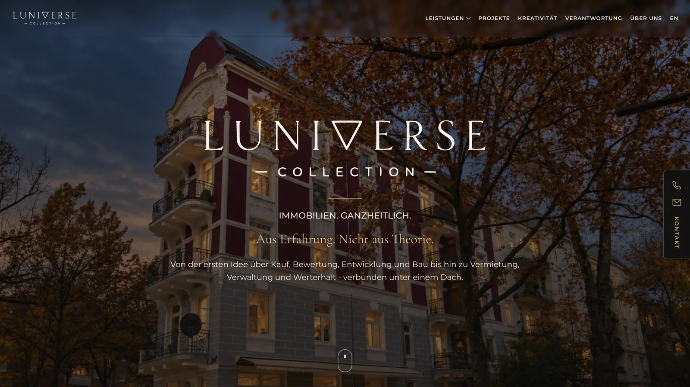

# Moe

**Web development · Linux and automation · Developer tools**

I build websites and practical tools, and I like the operations side too:
Linux servers, reverse proxies, deployment and CI.

**Stack:** TypeScript · Next.js · React · Node.js · HTML · CSS · JavaScript ·
Python · Linux · NGINX · GitHub Actions · Netlify

## LUNIVERSE Collection

A website for LUNIVERSE Collection, a real-estate company, in German and
English, built with Next.js, React and TypeScript as a static export on Netlify.

- German and English page trees with translated URLs, for example
  `/ueber-uns` and `/en/about-us`, linked to each other with `hreflang`
- cross-document page transitions with the View Transitions API: a photo tile
  grows into the photo at the top of the page it opens, off for visitors who
  prefer reduced motion
- a static export without the React client runtime: a post-build step strips
  it, so the pages run only the site's own plain JavaScript
- an image pipeline with sharp that writes AVIF, WebP and JPEG in up to three
  widths per image and respects EXIF orientation

[Visit the website](https://luniverse-collection.com) · The source code is private.

## Belegsuche

Local search for receipts, invoices and scanned documents on macOS. Text
recognition runs on the Mac with Apple's Vision framework, and the index is
SQLite full-text search, so no document leaves the machine.

- search rules for German documents: amounts like `1.234,56 €`, invoice
  numbers in different spellings, `Müller` = `Mueller`, street abbreviations,
  compound words and typos
- incremental indexing that survives an unplugged drive and resumes where it
  stopped
- search quality measured on a generated corpus of 64 fictitious files: the
  expected document ranks first for all 16 held-out queries
- 384 tests that run on macOS in CI with Python 3.11 and 3.12

[Source code](https://github.com/alsharmani0/belegsuche) · Documentation in German.

## Pfötchen

Pfötchen is a macOS desktop pet built in Swift. Bilini wanders across your
screen, takes naps and lets you pet her with the mouse pointer. You can switch
between a version made from her photos and a hand-drawn cat.

The source code is private.

## markusblaschyk.de

Website for a family-run construction company in Düren, built from HTML, CSS
and JavaScript and deployed by Netlify on every push to main.

- a small Python build script that assembles the pages from a shared layout,
  reads image dimensions from the files, adds `srcset` to the large photos and
  writes the sitemap, security headers and redirects from the old site's URLs
- no cookies, no tracking and no third-party requests: self-hosted fonts and
  an enquiry form that opens the visitor's email app instead of posting to a
  server

[Visit the website](https://www.markusblaschyk.de) · The source code is private.

## atelier-heimw.de

Website for a jewellery atelier in Eckernförde that also runs jewellery-making
workshops. Plain HTML and CSS with a little JavaScript, no framework and no
build step, hosted on Netlify.

[Visit the website](https://atelier-heimw.de) · The source code is private.

## How I work

I use AI coding agents such as Claude Code and Codex. I set the requirements,
review every change and am responsible for what ships.
